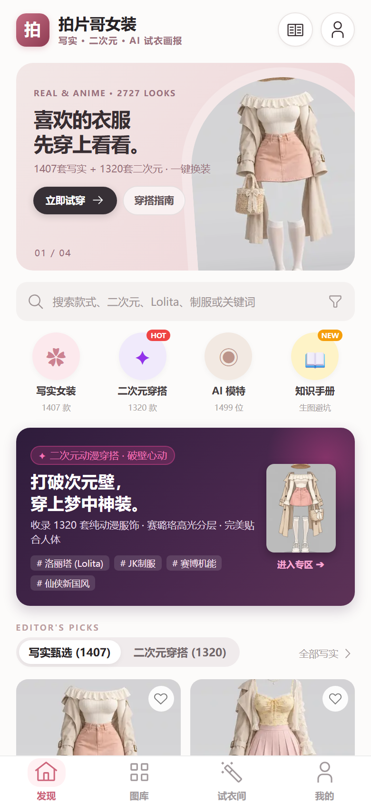
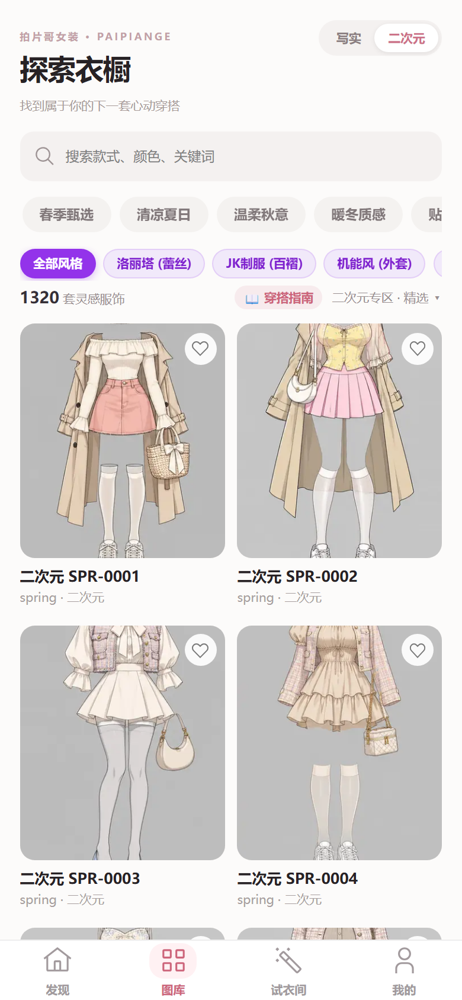
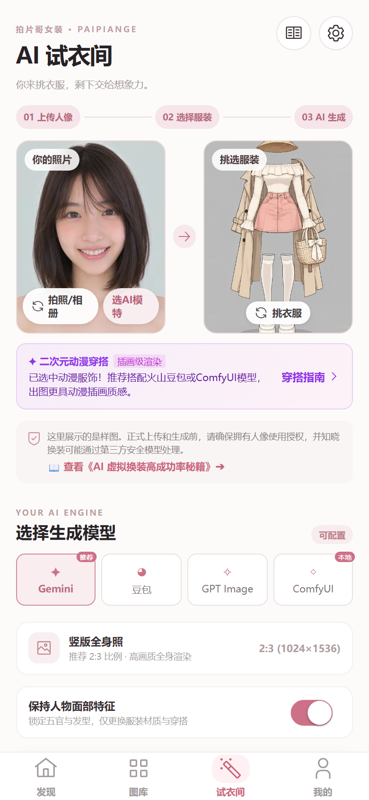
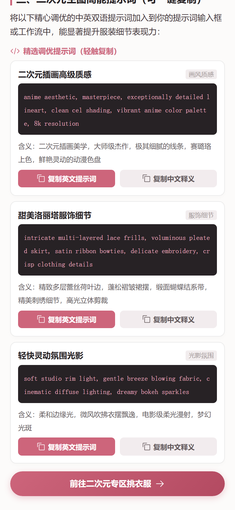
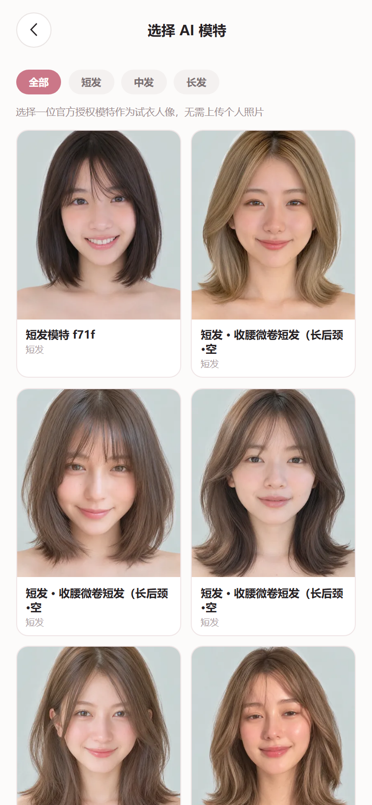

# 拍片哥女装 · AI 服装参考图集 (COSTUME-DB-01)

一个深色主题的纯净服装参考图集网站，收录 **2727 套**（写实真人版 1407 套 + 二次元动漫版 1320 套）人物不入镜的 AI 生成纯服装图像（2:3 比例），支持中英文双语浏览、多维检索，并配备可选的 AI 一键换装试穿。

> 👗 **【Linux.do 3级常任理事专属彩蛋】**  
> 听说在 [LINUX DO](https://linux.do/) 社区只要升到 **3 级（常任理事）** 就可以解锁“看女装大佬”的保留节目？身为一名尊贵的 Linux.do 3 级老兵，逛了一圈发现坛里的女装资源还不够看，干脆亲手搓了这个 **「拍片哥女装」** 项目！  
> 不仅收录了写实与动漫双图库合计 2727 套纯净高质量服装图，还顺手接了 AI 虚拟换装后端——这下各位佬友哪怕现实中没有小裙子，直接传张自拍照就能一键无痛变身“女装大佬”出道了 😂！

> 🔗 **在线预览**：https://paipiange.github.io/nvzhuang/  
> ⭐ **GitHub 源码**：https://github.com/paipiange/nvzhuang  
> 👤 **AI 模特脸部与造型图库**：集成自 [ai-portrait-gallery](https://ai-portrait-gallery.pages.dev/)（あぎ @agi_aibusi · CC0 1.0）  
> 💃 **兄弟项目（AI 姿势参考与生图工坊）**：https://github.com/paipiange/ai-pose-gallery-zh  
> 💡 **原作者推文 / 灵感来源**：X [@giaaibusi](https://x.com/giaaibusi)  
> 🐧 **社区友链**：[LINUX DO (https://linux.do/)](https://linux.do/)

## ⏱️ 10 秒了解本项目

- 🆓 **免费使用（无需部署 / 无需 Key）**：三大图库一键无缝切换：**写实服装 (1407 套) + 动漫服装 (1320 套) + AI 模特库 (1499 位)**，支持分类筛选、中英双语双向检索、大图全屏查看、基础搭配台与同款跳转，由纯前端静态驱动，在线打开即可使用。
- 👤 **内置 1499 位 AI 模特（全量本地化）**：完整集成 CC0 1.0 授权的 AI 模特脸部特写与造型图库，AI 试衣时可直接一键挑选心仪模特，彻底告别“想体验换装却找不到合适人像照片”的困扰。
- ⚙️ **自选扩展（需自建后端 / 需自备 Key）**：真实 AI 试衣换装功能依赖 `backend/` 的 GoFrame 服务。需自行配置大模型（如 GPT Image 2、豆包 Seedream 或 Gemini）的 API Key 与 Base URL，调用将消耗对应的第三方模型配额。
- 📜 **完全可商用 · 免费开源**：基于 [MIT License](LICENSE) 全量开源，代码与图集资源完全开放，支持自由商用创作、设计参考及二次开发。详见 [合规审计报告](docs/LINUXDO_RELEASE_AUDIT.md)。

## 📸 预览

### 📱 移动端与小程序界面预览

| ① 发现首页（双图库与破壁橱窗） | ② 图库专区（1320套二次元服饰） | ③ AI 虚拟试衣间（模特配置） |
| :---: | :---: | :---: |
|  |  |  |
| **精选推荐与双图库无缝切换**<br><sub>（二次元穿搭破壁橱窗、热门标签）</sub> | **1320套动漫服饰与风格筛选**<br><sub>（洛丽塔、JK制服、机能风一键过滤）</sub> | **真人/模特与二次元华服双向选择**<br><sub>（动漫插画级渲染专属引导横幅）</sub> |

| ④ 穿搭与生图知识库 | ⑤ 中英提示词词典（一键复制） | ⑥ AI 模特库（1499位商用人像） |
| :---: | :---: | :---: |
|  |  |  |
| **全方位穿搭与生图秘籍**<br><sub>（换装高成功率技巧、面料质感控制）</sub> | **图鉴级提示词与中英释义卡片**<br><sub>（轻触一键复制中英提示词至剪贴板）</sub> | **1499位免授权模特人像库**<br><sub>（支持短发/中发/长发发型多维挑选）</sub> |

### 💻 网页端界面预览

| 中文模式 | 英文模式 | 关键词搜索 |
|---|---|---|
|  |  |  |

## 👗 AI 换装效果演示

系统支持上传真实人像与选中的服装，通过 AI 生图大模型进行衣物迁移换装，实现精准保留面容、贴合人体形态的虚拟试穿效果，全面支持**写实真人**与**二次元动漫**双重换装风格：

### 1. 写实真人版换装效果

| ① 选中的服装（图 1） | ② 上传的模特照片（图 2） | ③ AI 换装合成效果（图 3） |
|:---:|:---:|:---:|
|  |  |  |
| **参考服装图**<br><sub>（写实图集精选女装）</sub> | **模特原图**<br><sub>（用户上传的人像日常照）</sub> | **AI 换装效果（图 1 + 图 2 ➔ 图 3）**<br><sub>（保留模特五官发型，自然融合服饰材质与剪裁）</sub> |

### 2. 二次元动漫版换装效果

| ① 选中的动漫服装（图 1） | ② 上传的模特照片（图 2） | ③ 二次元换装合成效果（图 3） |
|:---:|:---:|:---:|
|  |  |  |
| **动漫参考服装图**<br><sub>（动漫图集 1320 套精选二次元服饰）</sub> | **模特原图**<br><sub>（用户上传的真人模特人像照）</sub> | **动漫换装效果（图 1 + 图 2 ➔ 图 3）**<br><sub>（完美复刻真人神貌与身材特征，动漫插画级质感穿搭合成）</sub> |

## 🎬 兄弟项目联动：姿势参考 + 人物参考 → AI 生成结果

如果你不仅想为模特挑选服装，还希望**自由掌控人体的拍摄姿势、骨架动作与构图视角**，推荐搭配我的另一个开源项目一起使用：  
👉 **[拍片哥 · AI 姿势参考库与生图工坊 (AI Pose Gallery & Studio)](https://github.com/paipiange/ai-pose-gallery-zh)**

该项目收录了 **288 组 / 1439 张** AI 人体多视角姿势参考图（日文数据完整汉化），内置「拍片哥 AI 姿势生图与试穿工坊」，支持骨架动作锁定、真实面料试穿与面容复刻：

选择姿势骨架控制动作与构图，再上传人物/服装参考，即可生成同时保留目标姿势、人物面容与穿搭特征的完整图片：

| ① 姿势与构图参考 | ② 人物与服装参考 | ③ AI 融合生成结果 |
| :---: | :---: | :---: |
|  |  |  |
| **锁定身体动作、视角与画面构图**<br><sub>（从 1439 张多角度姿势库中挑选骨架素体）</sub> | **提供面容、发型与服装特征**<br><sub>（结合本项目精选服装或上传的模特穿搭）</sub> | **AI 融合生成结果（图 1 + 图 2 ➔ 图 3）**<br><sub>（动作精准还原，完美呈现人物与穿搭细节）</sub> |

> **上图即实际工作流：图 1 + 图 2 → 图 3。** 人物头像与服装均为可选输入；只选择姿势，也可以让模型自动完成人物与穿搭设计。  
> 💡 **联动工作流**：在 [拍片哥女装](https://github.com/paipiange/nvzhuang) 挑选高质量服装设计，在 [拍片哥姿势库](https://github.com/paipiange/ai-pose-gallery-zh) 挑选合适的人体动作构图，两者结合即可生成兼具神韵动作与精美穿搭的专业级 AI 模特大片！

## ✨ 功能特性

- **三大图库模式**：内置 **写实服装 (1407 套)**、**二次元动漫服装 (1320 套)** 与 **AI 模特脸部/造型库 (1499 位)**，合计收录超 4200 组高质量参考素材，支持一键无缝切换
- **AI 模特免相册试穿**：在 AI 试衣间内可直接从 1499 位精选模特（Face 纯脸特写 / Styling 造型）中一键挑选并置入，免去自备相册照片门槛
- **细分发型分类与多维检索**：模特库支持按短发、中发、中长发、长发以及 50 种具体发型（如波波头、微卷、一刀切等）精准筛选与中日英检索
- **8 大服装分类**：春 / 夏 / 秋 / 冬 / 内衣 / 派对 / 泳装 / 性感
- **中英文双语**：默认中文，右上角一键切换 English
- **双向检索**：中文（白、蕾丝、连衣裙…）和英文（white、lace、dress…）关键词都能搜索
- **关键词本地化**：中文模式自动将服装属性翻译为中文展示
- **交互体验**：分类筛选、实时搜索、无限滚动加载、放大查看、键盘 ←/→ 切换、Esc 关闭、原尺寸 PNG 下载
- **AI 试穿搭配台**：上传人像后可从图库选服装，也可上传自己的服装图片；自定义服装支持 1 张完整全身穿搭，或按顺序上传 2 张上半身 / 下半身服装
- **明确错误反馈**：换装校验、接口限流、鉴权和服务异常会同时显示页内提示与可聚焦弹窗
- **黑白主题**：默认白色主题，可在图库页和试穿页切换黑色 / 白色主题，并记住本机选择
- **浏览器设置中心**：可保存自己的后端地址、Base URL、API Key、接口协议与模型名；个人配置只保存在当前浏览器，后端仅按单次请求临时使用
- **本机生成记录**：AI 换装成功后自动保存到当前浏览器的 IndexedDB，可随时查看、下载、单条删除或全部清空，不上传、不跨设备同步

> 自定义上传的服装原图仅保留在当前页面内存中，不写入本地存储或生成记录；刷新或关闭页面后会自动清除。生成时只将压缩后的图片内容发送到用户配置的换装后端。
- **电商以图搜同款**：大图详情与试穿操作区支持一键唤起淘宝图片搜索，快速查找现实中在售的同款服饰
- **ComfyUI 本地离线生图**：支持零成本、免 API Key 本地私密运行；集成阿里开源 **Qwen-Image-Edit-2511 (Int8) + 4 步极速 Lightning LoRA** 与 **MiniMax H3** 双工作流，具备自动容灾回退能力

## 🤖 AI 换装（可选功能）

「AI 换装」需要一个后端服务，把服装真实地「穿」到人像上。后端位于 `backend/`（GoFrame v2），支持**多模型可插拔**：

| 模型别名 | 模型 | 协议 | 说明 |
|---|---|---|---|
| `comfyui` | **Qwen-Image-Edit-2511**（优先） / MiniMax H3 | ComfyUI 本地 API | **本地零成本离线方案**，4 步极速换装，无审查限制，未就绪自动回退 H3 |
| `gemini` | **Nano Banana 2**（`gemini-3.1-flash-image`） | Google generateContent | **云端推荐默认**，对真人换装场景无 moderation 阻断 |
| `doubao` | 豆包 Seedream（火山方舟） | 火山方舟 | 国内可用，无需代理网络 |
| `gpt-image` | **GPT Image 2**（`gpt-image-2`） | OpenAI Images | 兼容 OpenAI 协议，支持第三方中转与代理 |
| `qwen` / `zhipu` / `siliconflow` … | 通义万相 / 智谱 CogView / 硅基流动 | OpenAI Images 兼容 | 按需在配置中开启 |

> 三个关键点都可配置：**API Key、Base URL、模型名**。加一个国内模型只需在配置里新增一段，无需改代码。

前端 AI 试穿页右上角提供「设置中心」，支持两种使用方式：

1. **服务器预设**：继续使用后端 `config.yaml` / 环境变量中的模型配置。
2. **个人模型配置**：在当前浏览器保存协议、Base URL、API Key 和模型名，生成时随本次请求临时发送给后端。后端不把这些字段写入数据库、配置文件或业务日志。

> 浏览器本地保存适合个人设备使用。共享设备使用完毕后，请在设置中心点击「清除本地配置」。个人 Base URL 默认禁止指向 localhost、内网和保留地址，避免公开后端被用作内网请求代理。

### 配置模型

编辑 `backend/manifest/config/config.yaml`（模板见 `config.example.yaml`）：

```yaml
llm:
  models:
    gpt-image:                     # 前端请求用的别名
      provider: openai             # 协议：openai / doubao / gemini
      apiKey: ""                   # 直接填 Key，或留空用环境变量
      envKey: "OPENAI_API_KEY"     # 环境变量名（优先级高于 apiKey）
      baseURL: "https://api.openai.com/v1"   # Base URL 可改（支持中转/代理）
      model: "gpt-image-2"         # 真实模型名

    doubao:                        # 豆包（国内可用）
      provider: doubao
      envKey: "ARK_API_KEY"
      baseURL: "https://ark.cn-beijing.volces.com/api/v3"
      model: "doubao-seedream-3-0-t2i-250415"

    gemini:
      provider: gemini
      envKey: "GEMINI_API_KEY"
      baseURL: "https://generativelanguage.googleapis.com/v1beta"
      model: "gemini-3.1-flash-image"
```

**接入任意 OpenAI 兼容的国内生图模型**（通义万相、智谱、硅基流动等），加一段即可：

```yaml
    qwen:                          # 通义万相示例
      provider: openai
      envKey: "DASHSCOPE_API_KEY"
      baseURL: "https://dashscope.aliyuncs.com/compatible-mode/v1"
      model: "wanx2.1-t2i-turbo"

    # 本地 ComfyUI（零成本离线极速换装，支持 Qwen-Image-Edit / MiniMax H3）
    comfyui:
      provider: comfyui
      baseURL: "http://127.0.0.1:8188"
      model: "qwen-image-edit-2511"
      workflowPath: "workflows/comfyui_qwen_image_edit_2511_api.json"
```

### 🎨 ComfyUI 本地离线模式（推荐：零成本、免 Key、超快速度）

如果你的电脑拥有独立显卡（或局域网有运行 ComfyUI 的主机），可以完全免 Key 使用本地生图：
1. 启动本地 ComfyUI（默认 `http://127.0.0.1:8188`）；
2. 放入 `Qwen-Image-Edit-2511` 的模型与 4 步 Lightning LoRA（详见 [`backend/README.MD`](backend/README.MD)）；
3. 打开网页右上角 **设置中心**，选择「ComfyUI 本地」，点击「测试连接」成功后保存，即可享受 4 步极速离线换装体验。系统已内置双模型自适应能力，未就绪时会自动回退至 H3 方案。

### 🚀 后端部署（优先推荐 Docker）

后端推荐使用 **Docker / Docker Compose** 部署，无需在宿主机安装 Go 编译环境，开箱即用。

#### 方式一：Docker Compose（推荐，最省心）

```bash
# 1. 复制环境变量模板并填入你的 Key（如国内免翻墙的豆包 ARK_API_KEY，或 OpenAI Key）
cp backend/.env.example backend/.env

# 2. 一键启动后端（内置开箱即用兜底，默认监听 8000 端口）
docker compose up -d

# 服务启动后监听在 http://localhost:8000
```

> 提示：若需深度定制模型或高级路由，可复制配置文件模板：`cp backend/manifest/config/config.example.yaml backend/manifest/config/config.yaml`（未复制时系统也会自动使用模板并稳定监听 8000 端口）。

#### 方式二：Docker Run 单命令运行

```bash
cd backend

# 构建镜像
docker build -f manifest/docker/Dockerfile -t costume-tryon .

# 运行容器（按需注入模型 Key，例如豆包或 OpenAI）
docker run -d --name costume-tryon \
  -p 8000:8000 \
  -e ARK_API_KEY="你的豆包ArkKey" \
  -e OPENAI_API_KEY="sk-你的OpenAIKey" \
  costume-tryon
```

#### 方式三：无 Docker 本地运行

- **Windows 用户**：直接双击 `backend/restart.bat` 一键自动编译并启动服务。
- **命令行运行**：
  ```bash
  cd backend
  # 可选：复制配置文件（不复制时也会自动安全回退加载模板并监听 8000）
  # cp manifest/config/config.example.yaml manifest/config/config.yaml
  export ARK_API_KEY="你的Key"   # Windows PowerShell 用 $env:ARK_API_KEY="你的Key"
  go run main.go                 # 服务稳定监听 :8000
  ```

### 🔗 前端对接后端

前端静态页面通过以下顺序识别换装后端地址（优先级从高到低）：

1. **设置中心**：用户在当前浏览器保存的「后端 API 地址」（跨源外部公网后端须使用 `HTTPS`）
2. **全局变量**：在 HTML 加载前配置 `window.AI_API_URL = "http://localhost:8000"`
3. **URL 参数**：`https://你的前端地址/?tryon=http://localhost:8000`（安全约束：为防止钓鱼窃取 API Key 与私密照片，`?tryon=` 仅允许同源或本机回环 `localhost/127.0.0.1`；外部后端须在设置中心显式保存）
4. **本地回退**：本地以 `localhost` 或 `127.0.0.1` 访问前端时，默认自动连接 `http://127.0.0.1:8000`

### 🛡️ 接口安全与资源限制（公网部署必备）

后端原生提供企业级调用鉴权与高防资源限制（详见 [`backend/DEPLOY.md`](backend/DEPLOY.md)）：

1. **接口访问鉴权**：支持 Bearer Token 校验，服务端安全保存 SHA-256 摘要与恒定时间防侧信道比对；前端设置中心支持单独保存「后端访问 Token」，不与大模型 Key 混淆。
2. **精确 CORS 白名单**：严格域名匹配，彻底杜绝跨域滥刷与盗链。
3. **频率与额度保护**：内置令牌桶限流（默认 10 次/分）与 UTC 自然日调用额度（默认 100 次/天），超限返回标准 `429` 业务码。
4. **并发控制**：全局（默认 2 并发）与单调用主体（默认 1 并发）严格锁定，模型生图不排队堆积。
5. **图片校验与前端自适应压缩**：
   - 仅支持 JPEG / PNG / WebP 真实图像内容探测，严格防范伪造扩展名与代码注入；
   - 单图上限 8 MiB、两图合计 16 MiB、长宽限制 256~8192 px、总像素严格限制在 2000 万以内（防止解压像素炸弹导致服务器 OOM）；
   - 前端上传照片时自适应缩放：任一边小于 256 px 时自动等比放大到合规尺寸，高清模式最长边 2048 px，并阶梯压缩（WebP 优先，质量 0.90~0.75）。

> 完整的多模型接入、生产环境 Nginx 反代与安全加固说明见 [`backend/DEPLOY.md`](backend/DEPLOY.md)。

## 🚀 前端本地启动

本项目前端是纯静态站点，无需构建。任选一种方式运行：

```bash
# 方式一：Python 内置服务器（推荐端口 3000，与后端 8000 端口独立不冲突）
python3 -m http.server 3000

# 方式二：Node 简单服务器
npx serve -l 3000 .

# 方式三：直接用现代浏览器打开 index.html
```

启动后在浏览器打开 `http://localhost:3000`。若同时启动了后端，本地换装开箱即连。

## 📁 目录结构

```
nvzhuang/
├── index.html          # 页面结构 + 样式 + 交互逻辑（含双语字典、AI 试穿搭配台）
├── data.js             # 1407 条服装数据（id / 分类 / 关键词 / 图片路径）
├── docker-compose.yml  # 一键启动后端 Docker 容器编排
├── assets/
│   ├── thumbs/         # 缩略图（webp，网格卡片用）
│   └── img/            # 展示图（webp，弹窗放大用）
├── docs/               # 文档图片、换装效果演示与姿势生图联动图
├── backend/            # AI 换装后端（GoFrame v2，可选）
│   ├── docker-compose.yml                 # 后端 Docker Compose 配置
│   ├── .env.example                       # 环境变量示例文件
│   ├── restart.bat / build.bat            # Windows 本地一键启动/重新编译脚本
│   ├── manifest/config/config.yaml        # 模型配置（Key / BaseURL / 模型名）
│   ├── internal/logic/tryon/              # 模型适配器（openai / doubao / gemini）
│   └── DEPLOY.md                          # 部署指南
└── .gitignore
```

> 注：原尺寸 PNG（约 1GB+）未纳入仓库，「下载原尺寸」按钮指向原站资源。

## 🔗 URL 参数

支持通过 URL 参数直接分享特定状态：

```
?lang=en          # 初始语言（zh 为中文，en 为英文，默认 zh）
?q=lace           # 初始搜索词
?lang=en&q=white  # 组合使用
```

## 💡 灵感来源与推荐项目

- **兄弟项目 / 姿势与生图工坊**：[拍片哥 AI 姿势参考库 (ai-pose-gallery-zh)](https://github.com/paipiange/ai-pose-gallery-zh) —— 288 组 / 1439 张多角度人体姿势，集成本地与多云端 AI 姿势生图与试穿工坊。
- **原作者 / 灵感来源**：[X @giaaibusi](https://x.com/giaaibusi) —— 诚挚鸣谢原作者对高质量 AI 服装图集的整理与创意分享！
- **社区友链**：[LINUX DO (https://linux.do/)](https://linux.do/) —— 真诚、友善、团结、专业的开源与技术极客社区。
- **审计与规范文档**：
  - [项目现状与开源合规审计报告 (LINUXDO_RELEASE_AUDIT.md)](docs/LINUXDO_RELEASE_AUDIT.md)
  - [图库内容合规与社区发布审查报告 (CONTENT_REVIEW.md)](docs/CONTENT_REVIEW.md)
  - [Linux.do 推广发布前核验清单 (LINUXDO_PUBLISH_CHECKLIST.md)](docs/LINUXDO_PUBLISH_CHECKLIST.md)

## 📄 开源许可证与使用规范

本项目基于 **[MIT License](LICENSE)** 协议完全免费开源，允许无限制商业使用：

- **开源协议**：[MIT License](LICENSE)，代码与资产完全免费开源，允许商业使用、自由修改、集成与分发。
- **商用与创作自由**：可完全免费用于各类个人与商业作品创作（如电商广告、服装设计参考、游戏资产、AI 图像与虚拟换装应用）。
- **生成属性声明**：所有图像均为 AI 生成（t2i）概念服装设计，非现实品牌商品照片。

## 📝 数据说明

数据存于 `data.js`，每条记录包含：

| 字段 | 说明 |
|---|---|
| `id` | 编号（如 `SPR-0001`） |
| `カテゴリ` | 分类（日文分类名，如「春」） |
| `キーワード` | 关键词（英文，空格分隔） |
| `サムネ` | 缩略图路径 |
| `画像` | 展示图路径 |
| `原寸` | 原尺寸 PNG 路径 |

> 说明：`カテゴリ`、`キーワード`、`サムネ`、`画像`、`原寸` 是数据原始的日文字段名，为保持与原站数据兼容而保留。网站会在前端自动将它们本地化为中文或英文展示。

### Data Fields (English)

Each record in `data.js` contains the following fields:

| Field | Description |
|---|---|
| `id` | Identifier (e.g. `SPR-0001`) |
| `カテゴリ` | Category (Japanese category name, e.g. "春" for Spring) |
| `キーワード` | Keywords (English, space-separated) |
| `サムネ` | Thumbnail image path |
| `画像` | Display image path |
| `原寸` | Full-size PNG path |

> Note: `カテゴリ`, `キーワード`, `サムネ`, `画像`, and `原寸` are the original Japanese field names kept for compatibility with the source data. The site localizes them to Chinese or English on the frontend automatically.

## Star History

<a href="https://www.star-history.com/?repos=nvzhuang%2Fnvzhuang%2Cpaipiange%2Fnvzhuang&type=date&legend=top-left">
 <picture>
   <source media="(prefers-color-scheme: dark)" srcset="https://api.star-history.com/chart?repos=nvzhuang/nvzhuang%2Cpaipiange/nvzhuang&type=date&theme=dark&legend=top-left" />
   <source media="(prefers-color-scheme: light)" srcset="https://api.star-history.com/chart?repos=nvzhuang/nvzhuang%2Cpaipiange/nvzhuang&type=date&legend=top-left" />
   
 </picture>
</a>

