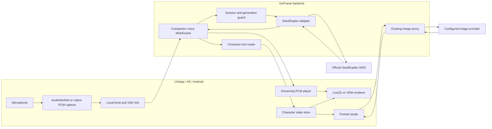
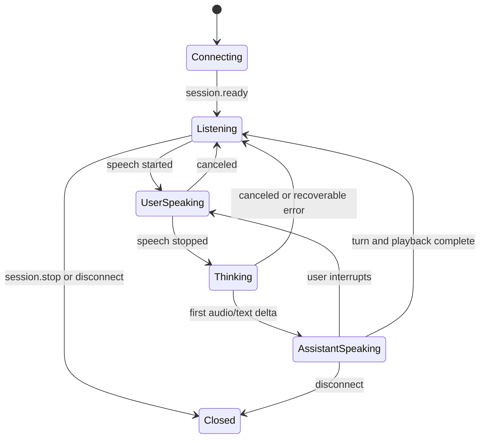

# AI 女友全双工语音与多形象系统实施规范

本文档用于指导开发 Agent 在现有 `nvzhuang2` 项目中实现可持续通话、可插话打断、可切换人脸/服装/姿势的 AI 女友。实现应复用现有 GoFrame、UniApp、SeedDuplex 和换装能力，不重写已经可用的本地语音与图片代理。

## 开始前必须遵守

- 不得提交真实 API Key、Token、私人地址、个人绝对路径或用户照片。
- 客户端手动输入的 SeedDuplex Key 只能保存在当前运行内存；服务端 Key 可来自 `backend/.env`、进程环境变量或被 Git 忽略的 `manifest/config/config.yaml`，不得记录到日志或提交到仓库。启动时应主动删除旧版本遗留的前端本地 Key 字段。
- 浏览器传入的模型地址必须继续执行现有同源、回环地址和 HTTPS 白名单校验，禁止页面指定任意语音上游。
- 人脸、服装、姿势和聊天记录默认保存在客户端；后端仅处理当前请求，不保存原始录音或生成图片。
- 保留 `local` 和 `open-llm-vtuber` 当前按轮协议。新增的持续流式行为仅对 `seeduplex` 启用，除非后续另有独立设计。
- 不得把“代码测试通过”描述成“真实云端账号验收通过”。真实 SeedDuplex 验收必须使用有权限的账号和真人麦克风完成。

## 交付目标

完成后，用户应能：

1. 点击一次“开始通话”后持续说话，不必每轮点击“结束录音”。
2. 在 AI 播放回复时直接插话，旧回复立即停止并取消上游生成。
3. 看到实时识别字幕、AI 回复字幕和流式音频播放状态。
4. 通过语音或界面切换角色人脸、服装和姿势。
5. 通话时立即更新轻量角色形象；需要高清结果时异步生成写真，不阻塞语音。
6. 退出页面、断网、切换引擎或取消后，不再播放迟到的旧音频。

本次不要求实现真人视频级实时生成。通话形象采用预制 2D/3D 角色资产；高清换装仍由图片生成模型异步完成。

## 当前实现证据与改造结论

| Evidence | Finding | Implementation path |
| --- | --- | --- |
| `app/src/pages/mine/voice.vue` 使用 `createScriptProcessor` 并把采样写入 `h5Chunks` | H5 会缓存完整一轮录音 | 改为 `AudioWorklet` 持续输出固定长度 PCM 帧 |
| `stopH5Recorder()` 才发送二进制 PCM 和 `input.end` | 当前必须手动结束录音 | SeedDuplex 通话期间持续发送二进制帧，由 VAD 划分回合 |
| `backend/internal/logic/voice/seeduplex.go` 在收到 `input.end` 后才把 `buffered` 交给 `startAudio()` | 后端仍按轮缓存，不是真正全双工 | 增加流式分支，音频到达即转发至官方上游 |
| SeedDuplex 上游已经返回 `response.output_audio.delta` | 上游具备流式音频 | 后端把 PCM 分片直接转发给客户端，不再聚合整段 WAV |
| `backend/api/tryon/v1/tryon.go` 当前主要输入为人物图和服装图 | 姿势不能被图片级精确控制 | 增加受控姿势引用，或在角色工作室中映射固定姿势资产 |
| `girlfriend/server.mjs` 已有头像、服装、六种姿势和多图生图 | 已具备角色工作室基础 | 抽取统一 `CharacterProfile`，让语音页和工作室共用 |

## 目标架构



语音链路是低延迟实时链路；高清图片链路是可取消的异步链路。二者不得互相阻塞。

## 实施阶段

### 阶段一：定义兼容的流式协议

保留现有 `/api/v1/voice/ws` 和 `/api/v1/companions/voice/ws`，在 `session.start` 中增加显式能力协商：

```json
{
  "type": "session.start",
  "provider": "seeduplex",
  "codec": "pcm_s16le",
  "input_rate": 16000,
  "streaming": true,
  "client_vad": true
}
```

服务端确认：

```json
{
  "type": "session.ready",
  "provider": "seeduplex",
  "streaming": true,
  "input_rate": 16000,
  "output_rate": 24000
}
```

客户端事件：

| Event | 用途 | 约束 |
| --- | --- | --- |
| 二进制 PCM | 持续发送麦克风音频 | 16 kHz、单声道、PCM16LE；建议每帧 20 ms，即 640 字节 |
| `input.activity` | 可选的本地语音活动提示 | 只用于 UI 和提前打断，不能代替服务端最终 VAD |
| `assistant.cancel` | 取消当前回复并丢弃播放队列 | 必须携带当前 `turn_id`，重复调用应幂等 |
| `session.reset` | 清空当前语音会话 | 清空当前回合、上游连接和迟到事件代次 |
| `session.stop` | 正常结束持续通话 | 停止麦克风、取消生成并关闭上游 |

服务端事件：

| Event | 用途 |
| --- | --- |
| `input.speech.started` | 上游或服务端确认用户开始说话 |
| `input.speech.stopped` | 确认本轮用户语音结束 |
| `asr.delta` / `asr.final` | 实时字幕和最终识别文本 |
| `assistant.text.delta` / `assistant.text.final` | AI 回复字幕 |
| `assistant.audio.start` | 声明后续二进制为流式 PCM，并包含采样率、声道和 `turn_id` |
| 二进制 PCM | AI 回复音频分片 |
| `assistant.audio.end` | 当前回复音频生成结束，不代表本地播放完成 |
| `assistant.cancel` | 服务端确认当前回复已取消 |
| `turn.end` | 当前模型回合结束 |
| `error` | 包含稳定的 `code`、安全的 `message` 和可选 `turn_id` |

流式模式禁止用无上下文的二进制包。服务端必须在连接状态中保存当前输入/输出 `turn_id`；客户端必须使用连接代次和回合代次过滤迟到包。

客户端还必须把服务端事件当作不可信输入进行防御性解析：

- 单条文本控制消息不得超过 64 KiB；JSON 必须是对象，且 `type` 必须是非空字符串。
- `type`、错误码和各类 ID 最长 64 个字符，`codec` 最长 32 个字符，安全错误信息最长 512 个字符。
- 单个文本字段及同一回合累计 ASR/回复字幕不得超过 20 KiB；超过上限立即结束当前会话，禁止继续扩张页面内存。
- 数字字段必须是有限数值，布尔字段不得接受字符串或数字替代。
- 未知上游错误码统一映射为 `seeduplex_unavailable`，客户端不得直接展示任意上游异常文本。
- 语音 WebSocket 地址只允许同源安全连接，或本机回环地址；禁止用户名、密码、查询参数和 URL 片段。非本机地址必须使用 `wss:`。

### 阶段二：改造 H5 持续采集

主要文件：`app/src/pages/mine/voice.vue`。复杂逻辑应拆到 `app/src/composables/voice/`，避免继续扩大单文件组件。

建议新增：

```text
app/src/composables/voice/
├── useDuplexSession.ts
├── usePcmCapture.ts
├── useStreamingPlayer.ts
├── voiceProtocol.ts
└── worklets/
    ├── pcm-capture.worklet.ts
    └── pcm-player.worklet.ts
```

采集要求：

- 使用 `navigator.mediaDevices.getUserMedia()`，请求单声道、回声消除、降噪和自动增益控制。
- 使用 `AudioWorkletProcessor` 读取音频，重采样为 16 kHz PCM16LE。
- 按 20 ms 或接近 20 ms 的固定帧发送；不得累计整轮后再发送。
- WebSocket `bufferedAmount` 超过安全阈值时短暂停止写入并显示网络拥塞，不能无限堆积内存。
- 继续计算 RMS 和峰值，但本地阈值只用于提示、静音保护和提前打断。
- 页面离开、切换 provider、连接关闭或权限撤销时，必须停止所有 MediaStream Track 并关闭 AudioContext。

`ScriptProcessorNode` 只能作为不支持 AudioWorklet 环境的降级方案。降级时可以回到原按轮模式，但必须在 UI 明确显示“当前设备不支持免提通话”。

Android/App-Plus 需要使用能够持续回调 PCM 的原生录音能力。若现有 RecorderManager 只能返回 MP3 分片或结束后的文件，则 SeedDuplex 全双工功能在该平台先标记为不支持，不能伪装成持续通话。

### 阶段三：改造 SeedDuplex 后端适配器

主要文件：

- `backend/internal/controller/voice/voice.go`
- `backend/internal/logic/voice/seeduplex.go`
- `backend/internal/logic/voice/conversation.go`
- `backend/manifest/deploy/nvzhuang-voice-local/voice.protocol.md`

实现要求：

1. `streaming:false` 或字段缺失时继续走现有按轮实现，保证兼容已有测试和客户端。
2. `streaming:true` 时，客户端二进制帧到达后立即编码并发送给 SeedDuplex，不写入整轮 `buffered`。
3. 独立 goroutine 负责上行音频、上游事件和客户端写入；所有 WebSocket 写操作必须串行化。
4. 收到上游用户开始说话事件时：
   - 增加当前生成代次；
   - 停止向客户端发送旧回复音频；
   - 向上游发送取消事件；
   - 通知客户端清空播放队列。
5. `response.output_audio.delta` 解码后立即转发 PCM 分片，并限制单帧、单回合和会话累计缓冲上限。
6. 取消、重置或断线后关闭上游连接，废弃旧代次的所有迟到事件。
7. 日志只能记录 provider、事件类型、耗时、字节数和错误码，不得记录 Key、识别文本、回复文本或原始音频。

状态模型：



### 阶段四：实现流式播放和插话

客户端不再等待完整 WAV。`useStreamingPlayer` 应维护一个小型 PCM 队列，通过 AudioWorklet 或 Web Audio 定时播放 24 kHz PCM16LE。

必须满足：

- 第一块可播放音频到达后尽快开始，目标缓冲为 60～120 ms。
- 按 `turn_id` 隔离队列；新回合不得与旧回合混播。
- 用户开始说话时立即静音并清空队列，然后发送 `assistant.cancel`。
- `assistant.audio.end` 只表示网络音频结束；队列真正耗尽后再产生本地 `playback.complete`。
- 播放回调、Blob URL、AudioBuffer 和计时器在取消后全部释放。
- 耳机环境应能自然插话；扬声器环境必须依赖系统 AEC，并提供“检测到回声时建议佩戴耳机”的提示。

### 阶段五：建立统一角色状态

建议新增客户端类型：

```ts
export interface CharacterProfile {
  characterId: string
  displayName: string
  personaId: string
  voiceId: string
  faceId: string
  outfitId: string
  outfitLibrary: 'real' | 'anime'
  poseId: string
  avatarModelId: string
  avatarType: 'static' | 'live2d' | 'vrm'
}
```

保存规则：

- 用户选择和角色配置保存在 `localStorage` 或 IndexedDB。
- 客户端 SeedDuplex Key 不属于角色配置或可持久化设置，只允许保存在当前 JavaScript/原生进程内存；刷新、关闭页面或退出应用后必须重新输入。长期服务端 Key 应放在后端 `.env` 或被 Git 忽略的 `config.yaml`。
- 保存图库 ID，不保存第三方 URL；读取时必须通过本地清单解析。
- 不把真实 API Key 放入 `CharacterProfile`。
- 切换角色时同步切换 persona、voice、face、outfit、pose 和 avatar，禁止只换脸但沿用错误身份记忆。

提供统一动作接口：

```ts
changeCharacter(characterId: string): void
changeFace(faceId: string): void
changeOutfit(outfitId: string, library: 'real' | 'anime'): void
changePose(poseId: string): void
generatePortrait(): Promise<GeneratedPortrait>
```

第一版可以由语音识别后的最终文本在本地执行严格意图匹配，例如“换成 12 号衣服”。后续如果接入支持工具调用的模型，再把以上方法暴露为受控工具。模型只能返回本地清单中的 ID，服务端不得接受任意文件路径或远程图片 URL。

### 阶段六：接入实时角色和高清写真

实时角色和高清写真必须分开：

| 能力 | 实时角色 | 高清写真 |
| --- | --- | --- |
| 技术 | Live2D、VRM 或预制静态角色 | 现有 Gemini/OpenAI 兼容/豆包/ComfyUI 图片代理 |
| 延迟 | 立即 | 数秒到数十秒 |
| 人脸 | 预制角色模型 | 人脸参考图 |
| 服装 | 预制贴图、部件或模型 | 服装参考图 |
| 姿势 | 动作/骨骼动画 | 姿势图片、OpenPose 或严格提示词 |
| 语音同步 | 音量或音素驱动嘴型 | 不适用 |

第一版无需绑定某个 Live2D/VRM SDK，但渲染器必须实现统一接口：

```ts
export interface AvatarRenderer {
  load(modelId: string): Promise<void>
  setExpression(name: string, weight?: number): void
  setPose(poseId: string): void
  setOutfit(outfitId: string): Promise<void>
  feedAudioLevel(rms: number): void
  dispose(): void
}
```

当前已在静态角色资产上实现动态 2D 运行时：音量驱动的四档嘴型、眨眼、呼吸和头部摆动，并支持 `prefers-reduced-motion` 与资产异常时的静态降级。该实现是音量嘴型，不是音素级唇形，也不声称静态图片已变成 Live2D/VRM 模型。后续接入经过绑定的 Live2D/VRM 资产时继续复用同一 `AvatarRenderer` 接口。

高清写真接口需要支持受控姿势：

- `pose_id` 必须来自后端固定清单。
- 清单可以映射到文字提示、项目内姿势图片或 ComfyUI OpenPose 资源。
- 若增加 `pose_image`，只允许项目清单解析出的本地资源或经过现有图片安全校验的上传内容。
- 人物、服装和姿势输入继续执行 MIME、文件头、尺寸、像素和总解码字节限制。
- 生成结果默认只返回客户端显示，不写入服务端磁盘。

## 错误处理

至少定义以下稳定错误码：

| Code | 场景 | 客户端行为 |
| --- | --- | --- |
| `duplex_not_supported` | 当前平台没有持续 PCM 采集能力 | 明确提示并允许切回按轮模式 |
| `microphone_denied` | 麦克风权限被拒绝 | 停止通话，提供系统设置指引 |
| `audio_backpressure` | WebSocket 长时间拥塞 | 暂停采集发送；超时后断开，禁止无限缓存 |
| `seeduplex_unavailable` | Key、权限、音色或网络错误 | 保留安全错误信息，允许重新连接 |
| `seeduplex_timeout` | 当前回合超时 | 取消回合并恢复监听状态 |
| `invalid_audio_frame` | PCM 长度、采样率或字节序异常 | 丢弃帧；连续出现则关闭会话 |
| `avatar_asset_missing` | 人脸、衣服、姿势或模型 ID 不存在 | 恢复上一个有效角色状态 |
| `portrait_generation_failed` | 高清写真失败 | 不影响语音通话，允许用户手动重试 |

任何错误都不得触发自动切换到另一个付费服务，也不得自动重复提交可能计费的图片或语音请求。

## 测试要求

### 前端自动化测试

在 `app/src/pages/mine/voice.test.ts` 和新增 composable 测试中覆盖：

- `streaming:true` 能力协商。
- 20 ms PCM 帧持续发送，而非等待停止录音。
- WebSocket 拥塞时不无限累计。
- 收到音频分片后按顺序播放。
- 用户插话后立即清空播放队列并发送一次幂等取消。
- 迟到音频、旧连接事件和旧 `turn_id` 不会恢复播放。
- 页面卸载后停止麦克风并释放播放器。
- 不支持 AudioWorklet 时明确降级。
- 切换人脸、衣服和姿势只允许清单内 ID。
- 高清生图失败不影响语音状态。

### 后端自动化测试

在 `backend/internal/logic/voice/seeduplex_test.go` 等测试中覆盖：

- 按轮旧协议继续通过。
- 流式二进制帧被立即转发，未等待 `input.end`。
- 多个音频 delta 能按序回传。
- 取消后旧上游事件被代次守卫丢弃。
- 用户插话时发送上游取消并开始新回合。
- 超大帧、奇数字节 PCM、过量缓冲和长时间无响应被拒绝。
- Key、文本和音频不会出现在测试日志输出。
- 同时连接的两个客户端不能串 Key、串音频或串会话记忆。

### 必须执行的命令

```powershell
Set-Location app
pnpm type-check
pnpm lint
pnpm test:run

Set-Location ..\backend
go test ./...
go vet ./...
```

若改动了 `girlfriend` 独立页面，还要运行：

```powershell
Set-Location ..\girlfriend
node server.test.mjs
node app.test.mjs
```

若改动了 `android` 原生壳，还必须使用 JDK 17、Android API 34 和 Build Tools 34.0.0，通过仓库内固定为 Gradle 8.6 的 Wrapper 执行：

```powershell
Set-Location ..\android
.\gradlew.bat --no-daemon testDebugUnitTest lintDebug assembleDebug
```

构建后必须使用 `apksigner verify --verbose` 验证 APK 签名，并确认包名、`minSdk 24`、`targetSdk 34` 和启动 Activity。`build:app` 只验证 UniApp 产物，不能替代 Android Java、Manifest、资源、DEX 和 APK 打包验证。若仓库位于 Windows 非 ASCII 路径，允许在 `gradle.properties` 启用 `android.overridePathCheck=true`，但仍须以真实构建结果确认工具链能够处理该路径。

### 真人验收

自动化测试通过后，使用已获授权的 SeedDuplex 账号完成：

1. 连续通话至少 10 轮，不点击每轮结束按钮。
2. 在 AI 开口后 1 秒内插话，确认旧声音立即停止且不会恢复。
3. 快速连续插话 5 次，确认无串音、无死锁、无重复播放。
4. 说出换脸、换装和换姿势指令，确认角色状态与界面同步。
5. 通话中发起高清写真，确认语音仍然可用，并能独立取消生图。
6. 断网、恢复网络、切换引擎和退出页面，确认麦克风与连接全部释放。

## 完成定义

只有同时满足以下条件才可宣称完成：

- H5 SeedDuplex 已实现持续开麦、流式上行、流式下行和插话打断。
- 不支持持续 PCM 的平台会明确降级，不会显示虚假的全双工状态。
- 现有 `local`、`open-llm-vtuber` 和按轮 SeedDuplex 测试未被破坏。
- 人脸、衣服和姿势通过统一 `CharacterProfile` 管理，并且只接受受控 ID。
- 实时角色变化不会等待高清生图；高清生图失败不会中断通话。
- Android 原生壳必须通过 Wrapper 编译、Lint、APK 签名校验，并另行完成物理设备麦克风/扬声器验收。
- 所有自动化门禁通过，并完成真实账号、真实麦克风验收记录。
- `backend/manifest/deploy/nvzhuang-voice-local/voice.protocol.md`、`girlfriend/VOICE-ENGINES.md` 和相关 README 已与实际行为同步。
- `git diff --cached` 与敏感字符串扫描确认没有真实 Key、Token、私人信息或本机配置进入提交。

## 产品级韧性与隐私补强

在核心全双工链路之上，语音页还必须具备以下运行保障：

- 浏览器在线/离线状态进入统一诊断，不在离线期间盲目发起连接。
- 用户主动开启持续通话后，非主动断开采用最多 5 次的有界指数退避重连；用户可立即重试或取消。
- H5 枚举音频输入设备，只在本地保存首选设备 ID；设备被拔出后回退系统默认输入。
- 通话建立后读取浏览器实际生效的回声消除、降噪和自动增益状态，并给出耳机或音量建议。
- 每个角色最多保存 50 条、总计不超过 60000 字符的纯文本对话记录；不保存音频、Key、Token 或请求头。
- 本地记录支持 JSON 导出、按角色删除和全部删除；诊断面板默认只显示数量，不直接展开私密文本。
- 页面隐藏、角色切换、手动结束与组件卸载必须取消重连并释放麦克风、播放器和网络连接。

对应实现与验收清单见：[AI 陪伴系统前 10 项完善计划](./2026-11-22_companion-top10-hardening-plan.md)。

## 建议提交拆分

按以下顺序提交，避免一个提交同时修改全部链路：

1. `refactor: 抽取语音协议与流式采集播放组件`
2. `feat: 为 SeedDuplex 增加持续音频流与插话打断`
3. `feat: 增加统一角色状态和形象切换动作`
4. `feat: 接入实时角色渲染与异步高清写真`
5. `test: 补充全双工语音和角色切换回归测试`
6. `docs: 更新语音协议和 AI 女友使用说明`
